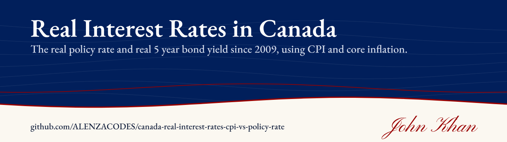
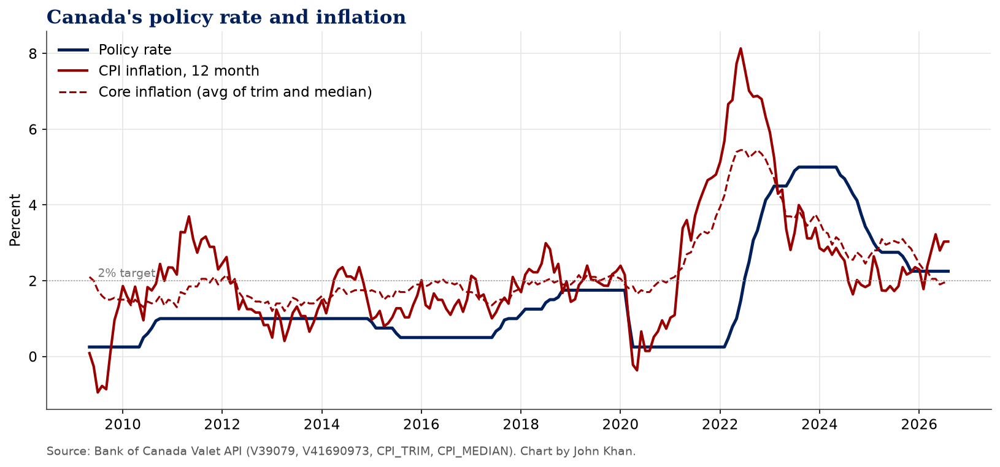
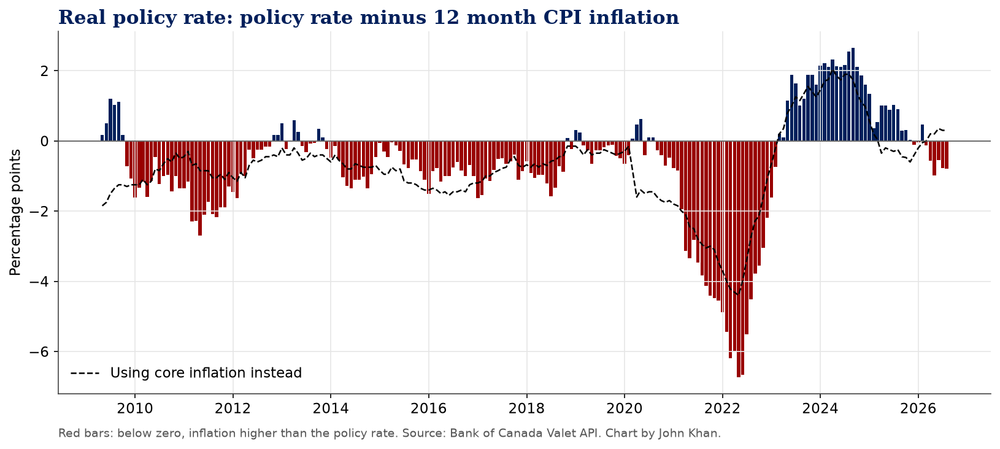
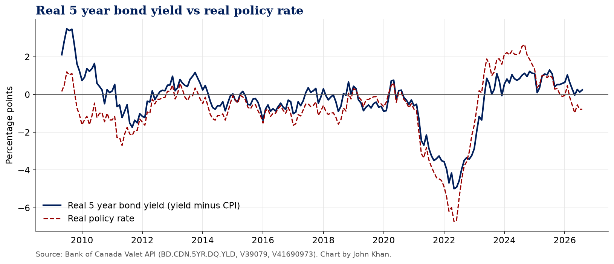

# Real Interest Rates in Canada Since 2009

**Canada's real policy rate and real 5 year bond yield since 2009, using CPI and core inflation from the Bank of Canada.**

[](https://www.kaggle.com/code/johnnykhan1/real-interest-rates-in-canada-since-2009) [](LICENSE) 

By John Khan

**Kaggle notebook:** [Real Interest Rates in Canada Since 2009 on Kaggle](https://www.kaggle.com/code/johnnykhan1/real-interest-rates-in-canada-since-2009)

## Question

What is Canada's policy rate after inflation, how long has it been below zero since 2009, and where does it sit now on headline and core inflation?

## Results

*Figures below are from the run on October 18, 2026, with CPI through August 2026.*

**1. Below zero is normal for Canada's real policy rate.** In 152 of the 208 months since May 2009 (73%), the policy rate was lower than 12 month CPI inflation. The longest stretch ran 59 months, from December 2013 to October 2018. Across 2010 to 2019 the real policy rate averaged minus 0.78 points.

**2. 2022 was the extreme.** The real policy rate stayed negative for 30 months, from September 2020 to February 2023. It bottomed at minus 6.73 points in May 2022, when the policy rate averaged 1.00% and CPI inflation was 7.7%.

**3. Then policy was genuinely tight for a while.** From 2023 on, the real policy rate averaged plus 0.92 points, and it sat above plus 2 points in 10 months. The peak was plus 2.65 points in September 2024 (policy 4.29%, CPI 1.6%).

**4. Now it depends on which inflation you use.** In August 2026 the policy rate was 2.25% and headline CPI inflation was 3.0%, so the real rate on headline CPI is minus 0.78 points and has been negative for six months, since March 2026. Against core inflation (1.95%), the real rate is plus 0.30 points. On headline, the real rate is right at its 2010 to 2019 average. On core, it is slightly positive.

**5. Fixed rate borrowers face a higher real rate than the headline suggests.** The real five year bond yield was plus 0.25 points in August 2026, about 1.03 points above the real policy rate, and above its 2010 to 2019 average of minus 0.17 points.

**What this means.** With headline inflation above the policy rate, money is not tight in real terms on the measure most people see. Core inflation tells a different story, and so does the five year bond, which is the rate that matters for anyone renewing into a fixed mortgage.

## Charts





## Quick start

```
pip install -r requirements.txt
jupyter nbconvert --to notebook --execute canada-real-interest-rates-cpi-vs-policy-rate.ipynb
```

On Kaggle, keep Internet on in the notebook settings, or upload the CSVs in `data/` as a dataset.

## Data and sources

* Bank of Canada Valet API, https://www.bankofcanada.ca/valet/docs
* `V39079` target for the overnight rate
* `V41690973` total CPI (Statistics Canada table 18-10-0004-01, https://www150.statcan.gc.ca/t1/tbl1/en/tv.action?pid=1810000401)
* `CPI_TRIM`, `CPI_MEDIAN` Bank of Canada core inflation measures
* `BD.CDN.5YR.DQ.YLD` 5 year Government of Canada benchmark bond yield

The notebook pulls everything live from the Bank of Canada Valet API. A snapshot of the data from the last run is in `data/`, and the notebook falls back to it if the API is unreachable.

## Licence

Code is MIT licensed. Data belongs to its publishers and is used under their terms (Bank of Canada: https://www.bankofcanada.ca/terms/, Statistics Canada Open Licence: https://www.statcan.gc.ca/en/terms-conditions/open-licence).

---

More of my work is on my [GitHub profile](https://github.com/ALENZACODES).
